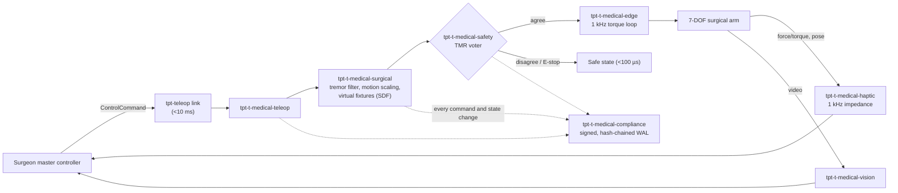

# Architecture

This is a skeleton. Crate responsibilities are taken from
[spec.txt](../spec.txt) §3, and the data flow from spec.txt §6. Each crate
gets a section here once it has an implementation.

## Workspace map

| Group | Crate | Responsibility | Status |
|---|---|---|---|
| Core & surgical control | `tpt-t-medical-core` | Event loop, surgical state machine, lock-free message bus | State machine, tick loop, per-producer lanes and audited wrapper done |
| Core & surgical control | `tpt-t-medical-surgical` | Motion scaling, tremor notch, SDF lookup, fixture force | Signal and geometry done; kinematics and RT timing pending |
| Edge & perception | `tpt-t-medical-haptic` | 1 kHz impedance rendering, hold-last-value on missed deadline | Contact model and hold logic done; pinned-core timing pending |
| | `tpt-t-medical-vision` | Stereoscopic pipeline, 3D reconstruction, AR overlay | Not started |
| Hospital logistics | `tpt-t-medical-logistics` | Delivery robots, infection-control zones, elevator arbitration | Zone rules and elevator arbitration done; path planning and MQTT pending |
| Hospital logistics | `tpt-t-medical-pharmacy` | Unit-dose packaging, FEFO dispensing, cold-chain logging | FEFO, cold-chain alerting and custody ledger done; packaging and barcode/weight pending |
| Hospital logistics | `tpt-t-medical-sterilize` | LiDAR room mapping, UV-C dosage, coverage validation | Dose planning and coverage validation done; LiDAR mapping pending |
| Safety & compliance | `tpt-t-medical-safety` | TMR voter, watchdogs, force limits, workspace envelope, E-stop | Pure logic done; RT timing and core-isolated copies pending |
| | `tpt-t-medical-compliance` | Hash-chained audit log, Ed25519 signatures | Chain, Ed25519 and file WAL done; O_DIRECT and hardware keys pending |
| | `tpt-t-medical-hipaa` | PHI encryption (AES-256-GCM), consent-token gating | Encryption, consent, revocation and access audit done; hardware key storage pending |
| Edge & perception | `tpt-t-medical-edge` | 1 kHz real-time arm control loop | Not started |
| | `tpt-t-medical-track` | Optical, EM and imaging tracking fusion, EKF | Not started |
| Foundations | `tpt-t-medical-ring` | Wait-free SPSC ring buffer (MPSC deferred) | SPSC core done, loom-verified |
| Telesurgery | `tpt-t-medical-teleop` | Adapter for the `tpt-teleop-domain-bridge` DTI | Not started |
| Bridges | `tpt-t-medical-bridge-hl7fhir` | HL7v2 ADT ingestion and output | ADT parser done; FHIR awaiting JSON dependency approval |
| | `tpt-t-medical-bridge-dicom` | DICOM query/retrieve and SR export | Metadata parser for uncompressed files done; network services and SR export pending |
| Tooling | `tpt-t-medical-sim` | Headless simulator with fault injection | Not started |

## Data flow: telesurgery

This is the flow from spec.txt §6, mapped to crates.

## Real-time boundaries

- The haptic and edge loops run on pinned cores with `SCHED_FIFO`. They must
  not allocate or take locks.
- Data moves between the vision/tracking threads and the haptic thread through
  a lock-free SPSC ring buffer.
- Audit writes are asynchronous to the control loops. A failed audit write is
  a safety event, not a silent drop.

## Open decisions

- Ring buffer: decided. `tpt-t-medical-ring` is a copy of the SPSC core from `tpt-t-ring`, not a path dependency on the sister repo. MPSC is deferred.
- Unicode-3.0 is in the `cargo deny` allow list, but spec.txt §2 does not list
  it (see [deny.toml](../deny.toml)).
- Signing library: decided. `ed25519-dalek` (BSD-3-Clause) with `sha2`. `ring` is not used: it is Apache-2.0 AND ISC, which the allow list rejects, and no exception is granted.
- AES-256-GCM: `aes-gcm` 0.10, not 0.11. Version 0.11 pulls in `ctutils` 0.4.2, which has RUSTSEC-2026-0385. The fix (ctutils 0.4.4) needs Rust 1.87, above the workspace MSRV of 1.85. Revisit when the MSRV moves.
