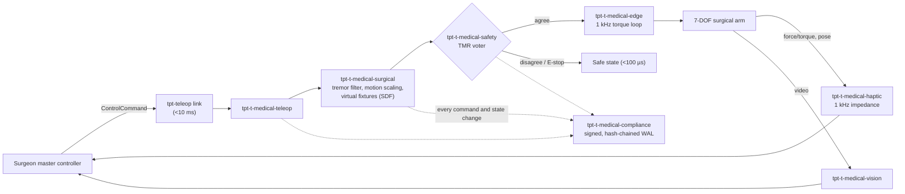

# Architecture

This is a skeleton. Crate responsibilities are taken from
[spec.txt](../spec.txt) §3, and the data flow from spec.txt §6. Each crate
gets a section here once it has an implementation.

## Workspace map

| Group | Crate | Responsibility | Status |
|---|---|---|---|
| Core & surgical control | `tpt-t-medical-core` | Event loop, surgical state machine, lock-free message bus | Not started |
| | `tpt-t-medical-surgical` | Master-slave kinematics, motion scaling, tremor filter, virtual fixtures | Not started |
| | `tpt-t-medical-haptic` | 1 kHz haptic rendering, impedance control | Not started |
| | `tpt-t-medical-vision` | Stereoscopic pipeline, 3D reconstruction, AR overlay | Not started |
| Hospital logistics | `tpt-t-medical-logistics` | Delivery robots, infection-control zones, elevator arbitration | Not started |
| | `tpt-t-medical-pharmacy` | Unit-dose packaging, FEFO dispensing, cold-chain logging | Not started |
| | `tpt-t-medical-sterilize` | LiDAR room mapping, UV-C dosage, coverage validation | Not started |
| Safety & compliance | `tpt-t-medical-safety` | TMR voter, watchdogs, force limits, workspace envelope, E-stop | Not started |
| | `tpt-t-medical-compliance` | Hash-chained, Ed25519-signed audit WAL | Not started |
| | `tpt-t-medical-hipaa` | PHI encryption, consent-token gating | Not started |
| Edge & perception | `tpt-t-medical-edge` | 1 kHz real-time arm control loop | Not started |
| | `tpt-t-medical-track` | Optical, EM and imaging tracking fusion, EKF | Not started |
| Foundations | `tpt-t-medical-ring` | Wait-free SPSC ring buffer (MPSC deferred) | SPSC core done, loom-verified |
| Telesurgery | `tpt-t-medical-teleop` | Adapter for the `tpt-teleop-domain-bridge` DTI | Not started |
| Bridges | `tpt-t-medical-bridge-hl7fhir` | HL7v2 ADT and FHIR ingestion and output | Not started |
| | `tpt-t-medical-bridge-dicom` | DICOM query/retrieve and SR export | Not started |
| Tooling | `tpt-t-medical-sim` | Headless simulator with fault injection | Not started |

## Data flow: telesurgery

This is the flow from spec.txt §6, mapped to crates.

## Real-time boundaries

- The haptic and edge loops run on pinned cores with `SCHED_FIFO`. They must
  not allocate or take locks.
- Data moves between the vision/tracking threads and the haptic thread through
  a lock-free SPSC ring buffer.
- Audit writes are asynchronous to the control loops. A failed audit write is
  a safety event, not a silent drop.

## Open decisions

- Ring buffer: reuse the `tpt-teleop` pattern or write `tpt-t-medical-ring`
  (todo.md, Phase 1).
- Unicode-3.0 is in the `cargo deny` allow list, but spec.txt §2 does not list
  it (see [deny.toml](../deny.toml)).
